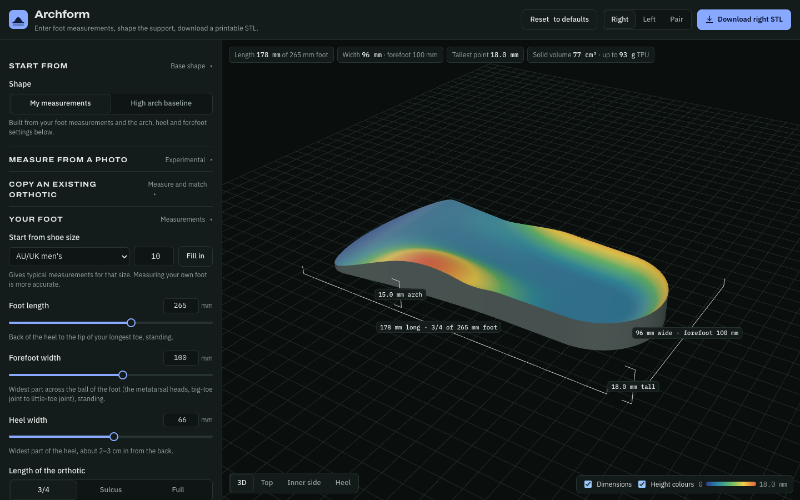

# Archform builder

The browser half of [Archform](../README.md). It draws the Archform shell, a thin moulded 3/4-length shape fitted to a 3D scan and exported from the Python tool with `ortho export`, lets you adjust the arch and heel cup with sliders, and downloads an STL ready for your slicer. No CAD skills, no install.

**Open it:** https://a-d-camp.github.io/archform/

This builder is a fork of [Orthotics Builder](https://github.com/markusg1234/Orthotics-builder) by markusg1234, used under the MIT licence. Archform is an independent project and isn't affiliated with or endorsed by the original author.



## What you can adjust

| Area | Settings |
|---|---|
| Shape | Arch height, arch position, arch length, how far across an arch change reaches, outer side, heel cup depth. Each is a change from the shape, so at zero you get it exactly. |
| Print | Thin shell or solid flat base, shell thickness, material (TPU, PETG, PLA) |

The preview updates live. You can view one foot or the pair, switch to top, inner-side and heel views, colour the surface by height, and show the length, width, overall height and arch dimensions on the model. The arch one stands where the arch actually peaks and gives the height of the inner edge there. A dimension the camera is looking straight down hides itself, so the top view drops the height and the heel view drops the length. The page warns you about settings that look unusual.

**Download** gives a binary STL in millimetres. The base sits on Z = 0 and the toes point along +X. Choosing **Pair** puts both feet side by side in one file. **Save settings** and **Load settings** keep your values in a small JSON file so you can come back and tweak them. The values are changes from the shape, so they still apply after the shape is refitted and exported again.

## Printing

| Material | Suggested settings |
|---|---|
| TPU 95A | 2–3 walls, 15–25% gyroid infill, 20–30 mm/s. Flexible and durable, the best all-round choice. |
| PETG | 4 walls, 30–40% infill. Firm shell, add a foam top cover for comfort. |
| PLA | Good for test fits only. It cracks under repeated flexing. |

The thin shell matches the shape: the same thickness everywhere, rounded underneath the heel cup and arch. Print it with supports under those. The solid style fills in flat underneath and needs no supports.

Make big arch changes in steps of about 2 mm, wearing each print for a few days before the next.

## How it works

The geometry engine (`src/geometry.js`) is plain JavaScript with no dependencies:

- **The shape.** `src/shape.js` is generated by `ortho export` from a design in `designs/`. It holds an outline table, the heel opening and a bicubic B-spline surface over (s along the shell, v across it), and the builder evaluates it to match the Python model to 0.01 mm.
- **Adjustments.** The arch changes move, stretch and raise the surface inside a smooth window around the arch peak, fading across the foot from the inner edge. The heel cup change adds to the walls by true distance to the edge.
- **Mesh.** A 150 × 56 grid, denser near the ends and edges, becomes a top surface, a bottom surface (offset square to the top for the thin shell, or flat) and side walls, with the heel opening cut out. The result is a closed, consistently wound mesh. Left feet are mirrored from right feet.

The page (`src/app.html`) uses [three.js](https://threejs.org/) for the preview and [JSZip](https://stuk.github.io/jszip/) for packaged downloads, both loaded from public CDNs.

## Development

```bash
python3 build.py              # inline src/shape.js and src/geometry.js into src/app.html → index.html
node tests/check_mesh.js      # watertightness and sanity checks across many settings
python3 build.py --check      # confirm index.html matches the sources
```

Edit the files in `src/`, then run `build.py`. `index.html` is generated, and it is the page you open or host. CI runs the mesh checks and the up-to-date check on every push, and every push to `main` deploys `index.html` to GitHub Pages (`.github/workflows/pages.yml`).

To run it locally, open `index.html` in a browser, or serve the folder with `python3 -m http.server`.

## Safety

These are general-purpose supports, not a medical device, and this tool does not diagnose or treat anything. If you have diabetes, poor circulation, numbness or ongoing foot pain, see a podiatrist before using orthotics you have made yourself.

## Licence

MIT. See [LICENSE](LICENSE). Original work copyright (c) 2026 markusg1234; modifications copyright (c) 2026 Andrew Camp.
